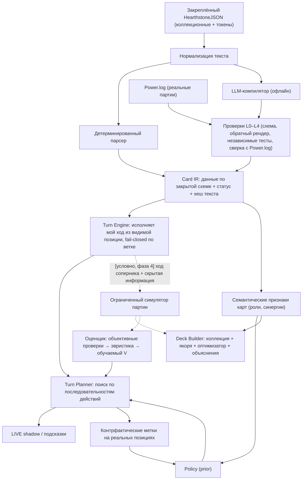

# FUTURE-ARCHITECTURE-RESEARCH-1 — симулятор, AI и автоматический подбор колод

Дата: 2026-10-26. Ветка `claude/future-architecture-research-1` от `main` `ae26cac`. Это исследование и проектное
предложение. Обучение не запускалось, checkpoint, датасеты, LIVE и ManaEngine не менялись, ничего не скачивалось.
Выполнены три небольшие read-only диагностики (раздел 0.2); их скрипты и вывод лежат рядом с этим файлом.

Статусы утверждений в отчёте:

- **[ФАКТ]** — проверено в коде, данных или измерено в этом исследовании;
- **[ВНЕШНЕЕ]** — взято из внешнего источника (ссылки в конце), не перепроверено запуском;
- **[ГИПОТЕЗА]** — реалистичное, но не проверенное предположение; для ключевых предложен эксперимент;
- **[ДОЛГОСРОЧНО]** — идея, которую имеет смысл рассматривать только после положительных ранних результатов.

---

## 0. Коротко

### 0.1 Ответ на главный вопрос

Превратить ManaMind в систему, которая «сама исследует Hearthstone», можно, но **не через полный симулятор Standard
как первый шаг**. Полный симулятор — это произведение трёх ненадёжных множителей: точность правил × качество
игрового агента × репрезентативность соперников. Сейчас все три близки к нулю, и ошибка любого обесценивает
сотни тысяч партий.

Рекомендуемое направление:

1. **Единый слой знаний о картах (Card IR).** Каждая карта описывается композицией общих примитивов (действия,
   селекторы, условия, источники чисел, триггеры, ауры). Описания **компилирует LLM** (а простые — детерминированный
   парсер), но LLM никогда не пишет код движка, только данные по закрытой схеме. Корректность проверяется
   **автоматически и независимо от LLM**: обратным рендером в текст, независимыми тестами, а главное — **сверкой с
   реальными Power.log**, где Hearthstone уже записал правильный ответ.
2. **Исполнитель хода (Turn Engine) вместо симулятора партии.** Он точно исполняет *мой ход* из реальной видимой
   позиции. Скрытая рука соперника не нужна, ход соперника не нужен. Покрытие измеряется **по реальным позициям**, а
   не по всему Standard: действие без поддержки получает отказ (fail-closed) только для этой ветки, а не для всей игры.
3. **Поиск по последовательностям действий внутри хода + оценщик позиции.** Это даёт прирост силы там, где
   imitation слабее всего: летал, порядок разменов, использование маны.
4. **Контрфактические метки на реальных позициях.** Planner оценивает альтернативы в *настоящих* позициях из логов, и
   Policy учится на этих оценках, а не только на выборе игрока. Синтетических состояний здесь нет, поэтому прошлая
   проблема shortcut learning на синтетике не повторяется.
5. **Deck Builder сначала без движка:** коллекция + правила колоды + известные сильные списки как якоря + модель
   качества/синергии карт (теги из Card IR) + объяснения. Симуляционная оценка колод появляется позже и только в
   ограниченном профиле.
6. **Полный симулятор (ход соперника, скрытая информация, self-play, массовая оценка колод)** — условная поздняя фаза.
   Начинать её стоит, только если пункты 1–2 покажут, что поддержка карт действительно стала дешёвой, и это
   подтвердится на очередном дополнении.

Первое, что стоит проверить, — экономику пункта 1. Это эксперимент **CARD-IR-PILOT-1** (раздел 8): 80 карт, ни
строчки движка, измеримые критерии успеха и провала.

### 0.2 Новые измерения этого исследования [ФАКТ]

| Измерение | Результат | Скрипт |
|---|---|---|
| Сколько карт текущего Standard (1185) полностью разбирает существующая грамматика `manamind.outcome` | **71 (6,0 %)**; ещё 266 разобраны частично | `census_standard_mechanics.py` |
| Доля Standard с семействами механик (по тексту) | Battlecry 32 %, случайность 19 %, призыв 18 %, урон 16 %, ключевые слова сетов 16 %, Deathrattle 14 %, история/счётчики 11 %, изменение стоимости 10 %, триггеры whenever/after 9,5 %, Discover 7,6 %, генерация в руку 8 % | тот же |
| Реальные решения (`real_policy_retrain_1`: 55 матчей, 2074 решения) — сколько уникальных карт в руке/на столах | **209**; 80 % появлений дают топ-26 ID, 90 % — топ-42, 95 % — топ-72 | `real_card_coverage.py` |
| Доля появлений карт, у которых **вообще есть текст** в закреплённых файлах | **82 %**: токены, сгенерированные и неколлекционные карты отсутствуют в collectible-снимке | тот же |
| Решения, где **все** сущности имеют текстовый источник | **25,7 %** | тот же |
| Решения, полностью покрытые декларациями ManaEngine | **1 из 2074** | тот же |
| Решения, полностью покрытые грамматикой forecaster | **6 из 2074 (0,3 %)** | тот же |
| Задержка Policy на CPU (1 поток), на одно решение | v2: кодирование 1,8–2,9 мс + forward 0,2–0,3 мс; v3: 2,0 мс + 0,7 мс | `policy_cpu_latency.py` |

Ограничение выборки: корпус смещён к Priest (см. POLICY-TACTICAL-ANALYSIS-1), и это обучающий, а не независимый
набор. Для оценки *концентрации* карт смещение скорее занижает разнообразие. Вывод «нужно мало карт» верен для
*своих колод*, но не для *соперников*.

Отсюда два практических вывода:

- **Концентрация высокая.** Для своих 1–2 колод нужны десятки карт, а не тысячи. Это подтверждает ставку на
  ограниченное, взвешенное по частоте покрытие.
- **Первый блокер — не механики, а метаданные.** 18 % появлений — это ID без текста в репозитории (токены, Монета,
  сгенерированные карты). Любой текстовый подход (Card IR, Text Policy, Outcome forecaster) упирается в отсутствие
  закреплённого **полного** (неколлекционного) снимка HearthstoneJSON. Его загрузка требует отдельного разрешения
  по правилам проекта (AGENTS.md), и это стоит сделать первым небольшим шагом.

---

## 1. Оценка существующего ManaEngine

### 1.1 Что реально есть [ФАКТ]

- ≈ 250 КБ C++ (`engine.cpp` — 152 КБ в 858 очень длинных строках), pybind-адаптер, ≈ 8 тыс. строк тестов
  (79 групп / 18 484 нативных assertion по отчёту миграции).
- `card_abilities.json`: **125 деклараций**, из них 102 `SUPPORTED`, 15 `VERIFIED_VANILLA`, 8 `UNSUPPORTED`; с учётом
  токенов и зависимостей. В реальных данных встречаются **19** из этих ID.
- Сессия создаётся только из двух колод и стартовой расстановки; допущены Mage/Priest/Hunter/Warrior с базовой силой
  героя. Импорта реальной позиции нет: ENGINE-STATE-IMPORT-0 показал 0/1227 гидратируемых позиций.
- Скорость (pass-only, Release): ≈ 32–55 полных «пустых» партий/с, `legal_actions` ≈ 0,04 мс, `apply_action`
  ≈ 0,04 мс, `clone` ≈ 5 мкс. Партий с осмысленными действиями никто не измерял.
- Сильные стороны: детерминированный RNG и глубокий `clone`; типизированные отказы (`FailureKind` / 57 `FailureCode`);
  контракт `SimulationAttempt` (`COMPLETED / UNSIMULATABLE / ILLEGAL / ENGINE_DEFECT`); манифесты пулов со статусами
  членства; evidence constraints; аккуратная модель урона (`damage_group_local_v1`) и лечения (`apply_healing`).

### 1.2 Почему поддержка карт была дорогой: четыре причины, а не одна

1. **Ядро не композиционное [ФАКТ].** `CardDefinition` — плоская структура, где рядом с общими полями лежат
   карточные (`dark_gift_*`, `shatter_*`, `spell_damage_attack`, `takes_damage_pool_id`, `held_spell_threshold`…).
   `Ability` — перечисление из 29 *именованных* обработчиков (`HeroAttackDraw`, `SpellDamageGainsAttack`,
   `RecruiterSummonRush`…), то есть по сути карточный код под другим именем. Общих `EffectKind` 14, селекторов 19,
   типов триггеров 5, окон секретов 6. Слоя аур и пересчёта стоимости нет. Новая механика почти всегда означает
   новое поле, новую ветку C++ и пересборку.
2. **Неясность правил [ФАКТ].** Работа над первой колодой остановилась не на объёме кода, а на вопросе порядка: когда
   пересчитывается Spell Damage между инструкциями (Sleet Storm + Time-Twisted Seer, чекпойнт H6). Ответ нашёлся
   лишь как сообщение на форуме. LLM эту проблему не решает: на вопросы о тонком порядке событий она отвечает
   правдоподобно, но без опоры на источник.
3. **Требование замыкания [ФАКТ].** Строгий профиль требует все достижимые исходы: Discover-пулы, случайные заклинания,
   токены. Чтобы честно сыграть одну колоду, нужна заметная часть Standard. Колода из 17 корней так и не получила
   статус DECK_READY.
4. **Процесс [ФАКТ + оценка].** Режим доказательств (независимые ожидания, evidence debt, аудит источников) правильно
   спроектирован для *канонических обучающих меток*. Но он применялся к каждому шагу разработки, поэтому стоимость
   одной карты измерялась сессиями. По истории git весь ManaEngine — 67 коммитов за 2026-10-03…10-09, и итог — около
   сотни деклараций.

Вывод: LLM-генерация деклараций сама по себе снимает только часть причины 1. Причинам 2 и 3 нужен **оракул**, а
причине 4 — **градуированная политика точности** (раздел 4.4).

### 1.3 Что переиспользовать

| Переиспользовать | Пересмотреть |
|---|---|
| Философию fail-closed, но на уровне *ветки/действия*, а не всей партии | Плоскую `CardDefinition` с карточными полями |
| Таксономию отказов и контракт `SimulationAttempt` | `Ability`-перечисление именованных обработчиков |
| Детерминированный RNG, clone, trace | Жёсткие типы триггеров/окон вместо общей шины событий |
| Знания о правилах: порядок урона, лечение, Reborn, пулы (как *тест-кейсы*) | Создание сессии только из колод (нужен старт из видимой позиции) |
| Манифесты пулов и статусы членства | Требование полного замыкания для любого полезного результата |
| 125 деклараций — регрессионный корпус для Card IR (их нужно перевести в IR без потерь) | Ставку на C++ как язык прототипирования механик |
| Адаптер в `GameState` и схему legal actions | — |

Отдельно: `manamind.outcome` (forecaster) **уже является частичной моделью правил на Python**: он применяет урон,
лечение, баффы и смерти к `GameState` и сверяется с логами. Поэтому третий движок не нужен. Рекомендация —
развивать исполнитель хода из forecaster поверх Card IR, а ManaEngine оставить замороженным эталоном для тонких
контрактов урона и лечения.

---

## 2. Можно ли сделать поддержку карт дешёвой

### 2.1 Что показывает опыт открытых проектов [ВНЕШНЕЕ]

| Проект | Подход | Чему учит |
|---|---|---|
| Metastone → **Spellsource** (Java) | Карта — JSON (`battlecry`/`trigger`/`spell: {class: SummonSpell, …}`, атрибуты); недостающая механика — новый Java-класс Spell; тесты на Java | Декларативное описание тянет большинство карт, но опирается на **большую библиотеку** классов эффектов и тестов. README заявляет «100 % карт Hearthstone с горсткой багов», но репозиторий сам отслеживает **230** нереализованных коллекционных карт; проект ушёл в собственные карты |
| **SabberStone** (C#) | Карточный код на общих задачах; тест на каждую карту | ≈ 98 % Standard 2019 года. Разработка остановилась в 2019, и проект сразу перестал покрывать актуальный Standard |
| **Fireplace** (Python) | Декларативный Python-DSL (селекторы, действия, эвалюаторы) | Красивый DSL, но поддержка доведена только до Witchwood (2018) |
| RosettaStone (C++) | Карточные задачи | Уже пройденный путь проекта (снят в MODEL-FIRST-MIGRATION-1) |
| **MTG Arena** (GRE) | Ядро C++ + правила карт на CLIPS; по вторичным сведениям, большая часть кода правил **генерируется из английского текста** NLP-парсером (не ML) | Самый сильный прецедент «текст → правила», но у Wizards огромная команда и контролируемый язык карт. Детали парсера официально не описаны |
| Forge (MTG) | Скрипт на карту | Масштаб держится на годах работы сообщества |

Общая закономерность: **все открытые симуляторы Hearthstone отстали от игры, как только кончилась работа
волонтёров.** Узкое место у них — не язык описания, а постоянный поток новых механик и проверка. Для проекта одного
человека LLM может заменить «волонтёров-авторов», но не «оракул правильности».

### 2.2 Насколько Hearthstone поддаётся декларативному описанию

| Класс механик | Доля Standard (по census) | Пригодность | Как описать в IR |
|---|---|---|---|
| Прямые эффекты: урон, лечение, броня, бафф, ключевое слово, заморозка, уничтожение, взять карту, призвать фиксированный токен | урон 16 %, призыв 18 %, взятие 11 % (перекрываются) | **Высокая** | `Action(selector, value)` |
| Метки момента: Battlecry, Deathrattle, Combo, Outcast, Choose One, конец/начало хода | 32 % / 14 % / 6 % … | **Высокая**, если есть шина событий | `Trigger(event, filter, actions)` |
| Условия и числа из состояния («если вы держите дракона», «за каждого…») | история/счётчики 11 % | **Средняя**: нужны общие счётчики истории | `Condition`, `ValueProvider(counter)` |
| Реактивные триггеры whenever/after | 9,5 % | **Средняя**: важен порядок | `Trigger` + явная фаза (before/after) |
| Ауры и изменение стоимости | 3,4 % / 10 % | **Средняя**: нужен слой непрерывного пересчёта | `Aura(selector, modifier, scope)` |
| Случайные цели и Discover из пула | 19 % / 7,6 % | **Средняя**: сам IR прост (`pool(predicate)`), трудно **членство пула** | `Pool(predicate)` + манифест; при тесте по логам исход инжектируется из лога |
| Генерация, копирование, трансформация с наследованием эффектов | 8 % / 4,5 % / 1,4 % | **Средняя/низкая**: нужен контракт копирования | `Copy(policy)` со списком наследуемого |
| Механики сетов (Rewind, Shatter, Imbue, Herald, Dark Gift, Kindred, Prepare, Colossal, Fabled…) | 16 % | **Низкая на первом появлении**, затем высокая | Новый примитив на механику (ревью человеком), дальше карты — данными |
| Квесты, уникальные легендарки, «перестраивают» другие карты (Elise-Location и т. п.) | единицы процентов | **Низкая** | `CUSTOM` с явным владельцем или навсегда `OPAQUE` |

Ранняя ручная оценка 100 карт (2026-09-29, по примитивам RosettaStone) дала AUTO 16 + COMPOSABLE 34, то есть
≈ 50 % выразимы существующими конструкциями, а CUSTOM 32 + MISSING_PRIMITIVE 16 требуют работы [ФАКТ, исторический].

[ГИПОТЕЗА] С IR, где словарь примитивов взят у Spellsource/Fireplace (≈ 40–60 примитивов), с шиной событий и слоем
аур выражается **60–75 %** карт по количеству и **больше по частоте** (простые карты встречаются чаще). Хвост
в 25–40 % — это механики сетов и уникальные карты. Каждое дополнение приносит 2–5 новых ключевых механик. Именно
эту гипотезу и проверяет CARD-IR-PILOT-1.

### 2.3 Предлагаемый конвейер карты

```text
HearthstoneJSON (закреплённый, с токенами) ─┐
                                           ├─▶ нормализация текста (уже описана в CARD-TEXT-AUDIT-1)
каталог механик/примитивов IR (версия N) ──┘
     │
     ├─▶ детерминированный парсер шаблонов (≈ 6–30 % карт; ошибка = отказ, а не догадка)
     └─▶ LLM-компилятор → IR (JSON по закрытой схеме) | или "NEEDS_PRIMITIVE: …" | или "OPAQUE"
              │
              ▼
  L0 схема и типы (allowlist, ссылки на существующие ID, диапазоны)
  L1 обратный рендер IR → канонический английский → сравнение с исходным текстом (детерминированный diff
     чисел/селекторов + независимый судья другой моделью)
  L2 независимые тесты: другая сессия LLM пишет ожидания ТОЛЬКО по тексту карты, не видя IR
  L3 сверка с реальными логами: каждое наблюдённое разыгрывание карты → публичные изменения (TAG_CHANGE,
     FULL_ENTITY, порядок BLOCK) сравниваются с исполнением IR; случайные исходы и выборы берутся из лога
  L4 человек — только для частых карт и для каждого нового примитива
              │
              ▼
  статус карты: DET_PARSED / LLM_ACCEPTED / LOG_VERIFIED / DISPUTED / OPAQUE  (+ хеш текста и версия IR)
```

Ключевые свойства:

- **LLM пишет данные, а не код.** Новые примитивы LLM может только *предложить*. Реализует их человек или агент
  отдельной задачей с ревью, и после этого карты из хвоста становятся данными.
- **Правдоподобные ошибки ловятся независимостью проверок.** Ошибка должна пройти схему, обратный рендер, тесты,
  написанные без знания IR, и сверку с логом. Если две независимые компиляции разошлись, карта уходит в
  `DISPUTED`.
- **Лог — оракул для вопросов порядка.** Power.log записывает фактическую последовательность блоков и изменений
  тегов. Вопрос «пересчитывается ли Spell Damage между инструкциями» решается одним залогированным разыгрыванием, а
  не поиском на форумах. В проекте уже есть экстрактор последствий (`manamind.evidence`, EVIDENCE-0B) и сверка
  прогнозов с логами (`verify_action_outcomes.py`).
- **Патчи.** Ключ кэша — `(card_id, хеш текста, версия IR)`. Изменился текст или статы — карта перекомпилируется и
  перепроверяется автоматически. Изменились только числа — обычно меняются только параметры IR. Метрика
  сопровождения — «часы человека до поддержки X % частотного покрытия нового дополнения».

### 2.4 Ограничения, которые надо признать заранее

- **L3 работает только для карт, которые реально встречались**, и только для публично наблюдаемых последствий.
  Редкие карты останутся на уровне L1/L2. Это приемлемо, потому что покрытие считается по частоте.
- **Сверка с логом требует старта из видимой позиции.** Полная гидратация ManaEngine невозможна, но для проверки
  *локального* эффекта нужен только срез: участвующие сущности, их статы и ключевые слова, мана, руки известной
  стороны. Это существенно проще полного импорта [ГИПОТЕЗА, проверяется на этапе TURN-ENGINE-0].
- **Скрытая информация соперника** (секреты, рука) ограничивает исполнение. Секрет — явная ветка «неизвестно»;
  исход не выдумывается.
- **Неправильная модель тонкого порядка** возможна даже после всех проверок. Поэтому каждый результат несёт статус
  точности, а канонические обучающие метки берутся только из `LOG_VERIFIED`/детерминированных путей.

---

## 3. AI Deck Builder

### 3.1 Варианты

| Подход | Нужен движок? | Данные | Сила результата | Стоимость | Надёжность |
|---|---|---|---|---|---|
| **DB-A. Адаптация известных сильных списков к коллекции** (якорь — колоды, которые вводит пользователь или берутся из разрешённых источников; замены по похожести/роли) | нет | 5–50 списков, коллекция | Высокая практическая: близко к мете | Низкая | Высокая, если якоря сильные |
| **DB-B. Модель качества и синергии + оптимизатор** (теги ролей/синергий из Card IR и текста; ограничения: 30 карт, ≤2 копии, ≤1 легендарка, класс, формат, коллекция; кривая маны; целочисленная/локальная оптимизация; веса калибруются learning-to-rank «сильная колода против случайной из коллекции») | нет | известные колоды разных патчей; свои партии | Средняя: разумные, объяснимые колоды; редкие неожиданные находки | Средняя | Средняя: оценка не равна винрейту |
| **DB-C. Статистика винрейтов** (HSReplay-подобные данные: винрейт с картой в колоде, mulligan) | нет | крупная внешняя статистика | Высокая для меты, ноль для новых сочетаний; смещение отбора | Низкая технически, но **доступ к данным неясен** (публичного API не нашлось; премиум-данные; условия использования нужно проверить) | Средняя |
| **DB-D. Эволюция/MAP-Elites + симуляция** | да, полный | движок + агент | Потенциально находит новое; на практике тянет к ошибкам движка/бота | Очень высокая | Низкая без калибровки |
| **DB-E. Суррогат + выборочные симуляции** (DSA-ME: нейросеть предсказывает исход колоды, симулируются только перспективные) | да | движок + агент | Как DB-D, в разы дешевле по вычислениям | Высокая | Как DB-D |
| **DB-F. LLM как сборщик** | нет | — | Полезна для объяснений и архетипных идей; без проверки ненадёжна | Низкая | Низкая |

[ВНЕШНЕЕ] Самый близкий научный результат — Deep Surrogate Assisted MAP-Elites (GECCO 2022) на SabberStone:
**180 карт** (Basic+Classic, один класс), 10 000 оценок × 200 партий, кластер из 200 CPU, 10–12 часов на прогон,
агент — маленькая сеть, специально обученная под колоду, потому что встроенные эвристические боты плохо играли
Rogue. Только 44 % найденных элит сохранили ячейку при переоценке. Это при полностью реализованном пуле из 180 карт
и вычислительном кластере.

### 3.2 Рекомендация

- **Сразу и дёшево — DB-A + DB-B без движка.** Импорт коллекции (кодов колод и экспорта коллекции из трекера —
  способ нужно уточнить), правила колоды, якорные списки, замены по ролям и синергиям из Card IR, кривая маны.
  Объяснение строится из тех же тегов: «замена X → Y: та же роль (ранний удаляющий эффект), стоимость ±1, синергия
  с драконами сохраняется». Это решает основной сценарий пользователя — «что я могу собрать из своей коллекции
  близко к сильному».
- **Позже — DB-E в ограниченном профиле:** свои колоды × 6–10 колод меты, агент = Policy + поиск хода, оценка
  вариантов (замена 1–4 карт), а не генерация колод с нуля. Такой локальный поиск вокруг сильного якоря требует на
  порядки меньше партий и меньше страдает от перекосов бота, чем MAP-Elites с нуля.
- **Неожиданные синергии** — честно долгосрочная цель [ДОЛГОСРОЧНО]. Её надёжно находит только полная симуляция с
  сильным агентом. Промежуточный вариант — «кандидаты синергий» из графа тегов IR, которые пользователь проверяет в
  реальных играх. Результаты накапливаются как данные.

---

## 4. Достоверность симуляций

### 4.1 Какое покрытие правил нужно

Для оценки матчапа нужны: все карты обеих колод + все их достижимые сгенерированные исходы + общие правила
(бой, смерти, усталость, мана). Discover-пулы класса — это сотни карт, поэтому строгое замыкание для одной колоды
быстро превращается в «половину Standard» [ФАКТ, история профилей]. Практичный компромисс:

- исходы из пулов, у которых нет надёжного IR, **не заменяются молча**. Партия помечается, и считается **доля партий
  с низкоточными событиями**;
- **анализ чувствительности:** те же матчапы прогоняются с двумя разными аппроксимациями неподдержанных исходов
  (например, «отказ партии» и «ближайшая по стоимости честная карта»). Если вывод о колоде меняется, он
  недостоверен;
- для обучения — только партии без низкоточных событий, с явной записью смещения отбора (выбрасывание неудобных
  партий само по себе меняет распределение; это уже зафиксировано в MANAENGINE_ADMISSION).

### 4.2 Агент

- Нужен агент, который **не делает грубых ошибок**: не пропускает летал, не делает самоубийственных атак, использует
  ману. Иначе выигрывают «простые» агрессивные колоды, которые слабый бот разыгрывает почти оптимально. Это
  известный эффект; в DSA-ME пришлось отдельно обучать агента под Rogue [ВНЕШНЕЕ].
- **Текущая Policy как агент** [ФАКТ + оценка]: технически подключаема (ManaEngine экспортирует `GameState`, схема
  действий общая; ≈ 2–3 мс на решение). Но она обучена имитации на 79 матчах (Priest — 45), её Top-1 совпадения с
  игроком ≈ 0,36–0,41, а на выборе разыгрываемой карты ≈ 0,15–0,17. Как самостоятельный агент для оценки колод она
  исказит результаты. Как **prior для поиска** — полезна.
- Против подгонки под одного бота: **ансамбль агентов** (Policy+поиск, эвристический scorer+поиск, разные глубины).
  Колода засчитывается, только если она сильнее у всех агентов, а не у одного.

### 4.3 Соперники, статистика, связь с реальностью

- Поле соперников = взвешенная по популярности мета из реальных данных, плюс «стресс-матчапы» (быстрая агрессия,
  контроль). Колода, сильная только против одного архетипа, помечается.
- Размер выборки при σ ≈ 0,5 (победа/поражение): чтобы отличить винрейт с точностью ±5 п. п. (95 %), нужно
  ≈ 385 партий; ±3 п. п. — ≈ 1 070; ±2 п. п. — ≈ 2 400 на пару колод. Сократить объём помогают: **парные партии** (одни
  и те же сиды раздачи и колод, стороны меняются местами), **последовательные тесты (SPRT)**, как в тестировании
  шахматных движков, и **racing/successive halving** при отборе кандидатов: плохие варианты отсеиваются после
  сотни партий.
- **Калибровка с реальностью:** на известных матчапах симуляционные винрейты сравниваются с реальной статистикой
  (если доступна) или с собственными партиями пользователя. Минимум — ранговая корреляция по 10–20 матчапам; без неё
  выводы симулятора не показываются пользователю как факт.
- **Детектор эксплойтов:** если колода резко лучше ожиданий, автоматически считается вклад карт (абляция по одной).
  Если прирост держится на картах со статусом ниже `LOG_VERIFIED`, результат помечается как вероятная ошибка
  движка.

### 4.4 Политика точности (предложение изменить правило)

Сейчас действует правило «не строить второй приближённый движок» и полный fail-closed. Предлагаю различать
**назначение** результата:

| Назначение | Допустимая точность |
|---|---|
| Канонические обучающие метки | только детерминированные + `LOG_VERIFIED` пути (как сейчас: строго) |
| Подсказка в LIVE (shadow) | исполнение с явными статусами; неподдержанное действие = отказ этой ветки |
| Исследование колод и вспомогательные оценки | допускаются `LLM_ACCEPTED` с измеренной частотой ошибок и анализом чувствительности; результат всегда помечен |

Это **изменение правил проекта**, и решение о нём за пользователем. Без него Card IR полезен для Text Policy и
Deck Builder, но не для симуляций.

### 4.5 Вычисления [ФАКТ + экстраполяция]

- Измерено: Policy ≈ 2–3 мс на решение на одном потоке CPU, и основную часть съедает Python-кодирование, а не
  сеть. ManaEngine — ≈ 0,04 мс на переход в C++, плюс конверсия в Python.
- По данным ≈ 38 решений SELF на матч, то есть ≈ 76 решений на партию → ≈ 0,2–0,3 с на партию при агенте «только
  Policy». Это **экстраполяция, не измерение**: порядка 3–5 партий/с на ядро, на 12 логических ядрах этого ПК —
  порядка 10⁵ партий в час без поиска.
- Поиск внутри хода умножает стоимость решения в 20–200 раз, так что получается 10³–10⁴ партий в час. Локальный
  поиск колоды (≈ 100 вариантов × 400–1 000 партий с отсевом) укладывается в часы–сутки. MAP-Elites с нуля
  (10⁴ × 200) — нет.
- Оптимизации, которые реально окупаются: батч-инференс по многим параллельным партиям; кодирование состояния без
  Python-словарей (или в нативном коде); кэш состояний и ходов; процессы вместо потоков. Переписывать движок на C++
  ради скорости стоит только после профилирования настоящих партий.

---

## 5. Может ли симулятор улучшить обучение

| Механизм | Применимость сейчас | Оценка |
|---|---|---|
| **Поиск по ходу + оценщик** (beam по последовательностям действий моего хода) | Turn Engine из реальной позиции, без скрытой информации | **Лучшее соотношение пользы и стоимости.** Прямо закрывает слабости imitation: летал, порядок, мана |
| **Контрфактические метки на реальных позициях** (expert iteration без полной игры) | Planner оценивает каждую альтернативу в настоящей позиции, и Policy учится на распределении оценок planner'а (дистилляция) | **Главный путь к силе сверх imitation при малых данных.** Состояния реальные, поэтому нет shortcut-ловушки синтетики (MODEL-FIRST-2) |
| Тактические навыки на контролируемых сценариях | уже пробовали | Прошлый результат: shortcut learning и регрессии. Допустимо только как тест, не как обучение |
| Улучшение Value Network | нужны исходы партий | Реальных партий ≈ 100–150, этого мало. Простой путь — оценщик конца хода из эвристики Strategic Scorer и объективных проверок; обучаемый V появится после полного симулятора |
| RL / self-play | нужен полный симулятор с ходом соперника и скрытой информацией | [ДОЛГОСРОЧНО]. Без высокой точности правил агент учится эксплуатировать ошибки движка |
| MCTS по всей партии | нужен information-set/determinization (уже записано как hard gate) | [ДОЛГОСРОЧНО]. ISMCTS/PIMC известны, но страдают от strategy fusion; сначала — поиск в пределах своего хода |

Почему предложение не повторяет ошибку MODEL-FIRST-2: там менялось **распределение состояний** (сгенерированные
позиции), и модель выучила артефакты генератора. Здесь распределение состояний остаётся реальным (позиции из логов),
меняется только **цель**: оценка альтернатив точным локальным исполнением. Риск другой — смещение оценщика позиции.
Поэтому начинать стоит с объективных тактических критериев (летал, выживание против видимого стола, точный обмен),
где оценщик не нужен или почти не влияет.

---

## 6. Сравнение стратегий

Оценки качественные (●●● — лучше). «Польза» — ожидаемый прирост силы решений и практической ценности.

| Стратегия | Польза | Стоимость | Данные | Новые дополнения | Надёжность | Вычисления | Постепенность |
|---|---|---|---|---|---|---|---|
| A. Model-first как сейчас (imitation + текст) | ●○○ | ●●● | ●○○ (нужно много партий) | ●●○ | ●●○ | ●●● | ●●○ |
| B. Ручной строгий симулятор (расширять ManaEngine) | ●●● в теории | ○○○ | ●●● | ○○○ | ●●● в пределах покрытия | ●●○ | ○○○ (полезен только почти целиком) |
| C. Card IR + LLM + полный симулятор сразу | ●●● в теории | ●○○ | ●●○ | ●●○ | ●○○ до калибровки | ●○○ | ●○○ |
| **D. Card IR + Turn Engine + поиск хода + контрфактические метки** | ●●○ | ●●○ | ●●● (работает на имеющихся логах) | ●●○ | ●●○ (fail-closed по веткам, сверка с логами) | ●●● | **●●●** |
| **E. Deck Builder без движка (якоря + IR-теги + оптимизатор)** | ●●○ для сценария коллекции | ●●● | ●●○ | ●●○ | ●●○ | ●●● | ●●● |
| F. Нейросимулятор (выученная модель мира из логов) | ●○○ | ●●○ | ○○○ (нужны десятки тысяч партий) | ●●○ | ○○○ | ●●○ | ●○○ |
| G. LLM как агент/симулятор | ●○○ | ●●○ | ●●● | ●●● | ○○○ | ○○○ (дорого и медленно для тысяч партий) | ●●○ |
| H. Взять чужой движок (Spellsource/SabberStone) | ●●○ | ●○○ | ●●● | ○○○ (не покрывают сеты 2025–2026, чужая кодовая база) | ●○○ | ●●○ | ●○○ |

Тупики и почему:

- **B** — подтверждено историей: неделя интенсивной агентской работы дала около сотни деклараций и ни одной
  готовой колоды. Внешние проекты с командами волонтёров остановились, как только иссяк поток работы.
- **F** — данных на порядки меньше, чем нужно; это может пересмотреться, только если появится крупный источник логов.
- **G** как массовый симулятор — непредсказуемая точность и цена на партию. Как объяснитель и компилятор IR LLM
  полезна.
- **H** как зависимость противоречит опыту с RosettaStone. Как **образец словаря IR** (Spellsource: SpellDesc,
  ValueProvider, Condition, EntityFilter, Trigger, Aura) — очень полезно; лицензию нужно проверить, код не
  копировать.

---

## 7. Рекомендуемая архитектура



Принципы:

1. **Один источник знаний о картах** (Card IR) обслуживает Turn Engine, признаки Policy и Deck Builder. Каждое
   вложение в карты окупается трижды.
2. **Покрытие измеряется по реальным позициям** (доля решений, где все действия исполнимы), а не по числу карт
   Standard.
3. **Отказ локален:** неподдержанное действие получает статус `UNSIMULATABLE`, и planner ранжирует остальные. Такой
   отказ не означает, что весь инструмент бесполезен.
4. **Код движка растёт по механикам, карты — по данным.** Примитив добавляется отдельной задачей с ревью; карта —
   компиляцией и проверкой.
5. **Ход соперника и скрытая информация — только после** доказанной экономики карт; там нужен reviewed
   information-set дизайн (он уже записан как hard gate).
6. **Язык:** прототип интерпретатора IR — на Python, рядом с forecaster (быстрые итерации с агентами). Перенос
   горячего пути в C++ — только по измерениям.

---

## 8. Дорожная карта

Сроки — ориентиры для экспериментов, не обещания. Каждая фаза заканчивается вердиктом GO / NO-GO.

| Фаза | Задача | Что даёт | Ворота |
|---|---|---|---|
| 0a | **METADATA-FULL-SNAPSHOT-1** (нужно разрешение на загрузку): закрепить полный снимок HearthstoneJSON той же сборки, только для текста/метаданных; vocabulary и catalog модели не меняются | Текст для 18 % появлений без источника | Воспроизводимость, без дрейфа каталога |
| **0b** | **CARD-IR-PILOT-1** (ниже) | Ответ, дешевеет ли поддержка карт | Критерии ниже |
| 1 | TURN-ENGINE-0: интерпретатор IR поверх `GameState` для немедленных эффектов, простых триггеров и боя; сверка с логами | Частотное покрытие решений | ≥ 50–60 % реальных решений полностью исполнимы; расхождение с логами ≤ 2 % проверенных событий |
| 2 | TURN-PLANNER-0: beam по своему ходу + объективные проверки; LIVE shadow | Летал, выживание, порядок разменов | Находит подтверждённые логами многоходовые леталы, которые Policy пропускает; ноль ложных «леталов» на проверенных позициях |
| 2' | DECK-BUILDER-0 (параллельно, без движка) | Колоды из коллекции с объяснением | Пользователь оценивает топ-3 предложения как играбельные; повторное открытие известных сильных списков из коллекции |
| 3 | COUNTERFACTUAL-LABELS-1: дистилляция planner → маленькая Policy (≤ 3 seed) | Сила сверх imitation | Улучшение на независимом holdout по объективным тактическим метрикам без потери CE/Top-1 |
| 4 | [ДОЛГОСРОЧНО] BOUNDED-MATCH-SIM: ход соперника, сэмплирование скрытого из априорных списков меты, ансамбль агентов, калибровка | Оценка колод, данные для V, позже RL | Ранговая корреляция с реальными матчапами; стабильность выводов при смене агента и аппроксимаций |

### 8.1 CARD-IR-PILOT-1 — конкретная следующая задача

**Гипотеза.** Карты текущего Standard можно описывать композициями общих примитивов настолько дёшево и надёжно,
что ручная работа идёт только на новые примитивы, а не на карты.

**Базовая линия.** Существующая грамматика forecaster полностью разбирает 6 % Standard; ManaEngine покрывает
19 из 209 реально встреченных ID; ручная оценка 2026-09-29: ≈ 50 % выразимы существующими примитивами.

**Объём (без кода движка, без обучения, без скачивания):**

1. Выборка фиксируется **до** компиляции (protocol lock, как в EVAL-протоколах): топ-50 коллекционных карт по частоте
   в реальных решениях + 30 карт стратифицированной случайной выборки из Standard (seed записан). Токены, которых
   нет в снимке, учитываются как зависимости.
2. **IR-схема v0** (JSON Schema): ≈ 30–50 примитивов, словарь заимствуется концептуально у Spellsource/Fireplace:
   действия, селекторы/фильтры, источники чисел, условия, триггеры (событие + фильтр + фаза), ауры, ключевые слова,
   пулы-предикаты; плюс `NEEDS_PRIMITIVE(описание)` и `OPAQUE`.
3. Перевести в IR **все 125 деклараций ManaEngine** как регрессионный корпус (проверка выразительности схемы и
   единственный источник «эталона», уже прошедшего ревью).
4. Компиляция 80 карт двумя независимыми проходами LLM (разные промпты; другая модель — по возможности).
5. Проверки L0 (схема), L1 (детерминированный обратный рендер + сравнение чисел/селекторов/ключевых слов с текстом),
   L2 (независимые ожидаемые последствия только по тексту для 2–3 сценариев на карту; исполняются вручную или на
   минимальном интерпретаторе, если он нужен меньше чем на ~300 строк поверх forecaster). L3 — только инвентаризация:
   для скольких карт выборки в логах есть наблюдённые разыгрывания (через `manamind.evidence`).
6. **Золотая разметка:** пользователь (опытный игрок) проверяет случайные 30 из принятых IR — правильно или нет. Это
   единственный способ измерить главное: **долю ложного принятия**.

**Метрики:**

| Метрика | Успех | Провал |
|---|---|---|
| Выразимость в IR v0 без новых примитивов (по частоте / по количеству) | ≥ 75 % / ≥ 60 % | < 55 % / < 40 % |
| Автоприёмка (прошли L0–L2, компиляции совпали) | ≥ 60 % | < 35 % |
| **Ложное принятие** среди автоприёмки (по золотой разметке) | ≤ 5 % | > 15 % |
| Время человека на принятую карту | ≤ 5 мин в среднем | > 20 мин |
| Новые примитивы: сколько и сколько карт каждый открывает | ≤ 10 новых закрывают ≥ 70 % хвоста выборки | каждый примитив — 1 карта |
| Карты выборки с наблюдёнными разыгрываниями в логах (для L3) | ≥ 60 % частых карт | < 30 % |
| 125 деклараций ManaEngine выражаются в IR без потерь | ≥ 90 % | < 70 % |

**Отрицательный результат** — любой из «провалов» в строках выразимости, ложного принятия или времени человека.

**Решение после пилота:**

- **GO** → TURN-ENGINE-0 и DECK-BUILDER-0 на основе Card IR; заодно IR-теги становятся кандидатом признаков для
  Text/Hybrid Policy (этап 3 роадмапа).
- **Частичный** (высокая выразимость, но ложное принятие 5–15 %) → обязательный L3 (сверка с логами) до любого
  использования; IR — только для признаков Policy и Deck Builder, не для исполнения.
- **NO-GO** → поддержку карт не автоматизировать. Остаться на Model-first: текстовые эмбеддинги (этап 3),
  контрфактические метки только там, где forecaster даёт EXACT; Deck Builder в варианте DB-A/DB-B на текстовых
  признаках без IR.

**Ограничения по правилам проекта:** не трогать ManaEngine, LIVE, checkpoint, каталог модели; не скачивать снимок без
отдельного разрешения (фаза 0a); выход — в новую папку `reports/card_ir_pilot_1/`; LLM-вызовы и стоимость
записываются.

### 8.2 Решения, которые нужны от пользователя

1. Разрешить ли **фазу 0a** — загрузку и закрепление полного (неколлекционного) снимка HearthstoneJSON той же сборки.
2. Согласен ли пользователь на **политику точности по назначению** (раздел 4.4) — ослабление правила «никакого
   приближённого движка» для исследовательских инструментов при сохранении строгости для канонических меток.
3. Стоит ли **forecaster (`manamind.outcome`) становиться основой Turn Engine** вместо развития ManaEngine.
   Рекомендация — да, ManaEngine остаётся замороженным эталоном.
4. Нужен ли **Deck Builder без движка** сразу параллельно (дёшево, полезно), или только после пилота.

---

## 9. Критика исходных предположений

- **«Policy учится повторять игроков — это главная проблема».** Отчасти. Не менее важно, что данных очень мало
  (79 матчей на обучение, смещение к одному классу), а текста карт во входе Policy нет. Даже с идеальной целью
  модель на таких данных не станет сильной. Поиск компенсирует это лучше, чем смена функции потерь.
- **«Симулятор даст сотни тысяч партий, и из них вырастут сильные колоды».** Объём партий — самая дешёвая часть.
  Дороги точность правил, агент и поле соперников. Литература получила хорошие результаты только на 180 полностью
  реализованных картах и с кластером.
- **«LLM сделает поддержку карт дешёвой».** LLM удешевляет *авторство*, но не *проверку* и не *новые механики*.
  Решающий вклад — оракул из реальных логов, который у проекта уже есть и который открытые симуляторы не
  использовали.
- **«Нужен полный Standard».** Для своих колод — нет: 80 % появлений дают 26 карт. Для соперников покрытие нужно
  шире, но в Turn Engine их карты чаще всего нужны только на столе (статы, ключевые слова, триггеры), а не их
  розыгрыш.
- **«Строгий fail-closed везде».** Правильно для канонических меток, но в роли ворот для исследовательских
  инструментов это правило не дало ManaEngine дойти до полезного покрытия. Строгость стоит привязать к назначению
  результата.

---

## 10. Воспроизведение диагностик

Запускать из корня основной рабочей копии (там лежат игнорируемые `data/`):

```powershell
.\.venv\Scripts\python.exe -I reports\future_architecture_research_1\census_standard_mechanics.py
.\.venv\Scripts\python.exe -I reports\future_architecture_research_1\real_card_coverage.py data\processed_policy_real\real_policy_retrain_1
.\.venv\Scripts\python.exe -I reports\future_architecture_research_1\policy_cpu_latency.py
```

Вывод этого запуска сохранён в `diagnostics_output.txt`. Скрипты только читают данные и печатают агрегаты (без
game ID и имён игроков). Census использует простые регулярные выражения по тексту: это оценка семейств механик, а
не классификация правил. Задержка Policy измерена на AMD (Family 25), 1 поток, 200 решений; между прогонами
кодирование колебалось в пределах 1,8–2,9 мс.

## Источники

- [Spellsource (hiddenswitch)](https://github.com/hiddenswitch/Spellsource) и [Spellsource-Server README](https://github.com/carlhu/Spellsource-Server) — формат JSON-карт, тесты, заявления о покрытии и 230 недостающих картах.
- [SabberStone](https://github.com/s13n4/SabberStone), [зеркало README 2019](https://gitee.com/dch0319/SabberStone) — покрытие Standard 2017/2019.
- [Fireplace](https://github.com/cfd1/fireplace) — Python-DSL, поддержка до Witchwood.
- [MTG Arena: On Whiteboards, Naps, and Living Breakthrough](https://magic.wizards.com/en/news/mtg-arena/on-whiteboards-naps-and-living-breakthrough) — ядро C++ + CLIPS; [обсуждение генерации правил из текста](https://tildes.net/~comp/14xt/why_i_decided_not_to_do_emrakul_and_how_we_shipped_it_anyway) (вторичный источник).
- [Fontaine et al., Mapping Hearthstone Deck Spaces through MAP-Elites with Sliding Boundaries (2019)](https://arxiv.org/abs/1904.10656).
- [Zhang et al., Deep Surrogate Assisted MAP-Elites for Automated Hearthstone Deckbuilding (GECCO 2022)](https://arxiv.org/abs/2112.03534).
- [Dockhorn & Mostaghim, Introducing the Hearthstone-AI Competition](https://arxiv.org/abs/1906.04238); [The Many AI Challenges of Hearthstone](https://arxiv.org/abs/1907.06562).
- [Cardiverse: Harnessing LLMs for Novel Card Game Prototyping (EMNLP 2025)](https://preview.aclanthology.org/credits/2025.emnlp-main.1511); [Code Generation for Collectible Card Games with Complex APIs (FLAIRS)](https://journals.flvc.org/FLAIRS/article/view/133044).
- [HSReplay.net statistics](https://hsreplay.net/articles/7/introducing-hsreplaynet-statistics), [mulligan data (Premium)](https://articles.hsreplay.net/2020/07/23/card-mulligan-data/) — публичного API найти не удалось.
- [Slightly Magic: List of MTG Engines](https://slightlymagic.net/wiki/List_of_MTG_Engines) — Forge/Magarena как подходы к скриптам карт.

Внутренние: `docs/history/CARD_SUPPORT_ANALYSIS_20260929.md`, `reports/manaengine_phase4b_20261004/STATUS_AND_ARCHITECTURE_CHECKPOINT.md`,
`reports/manaengine_hardening_20261003/BENCHMARKS.md`, `reports/model_first_migration_1/README.md`,
`reports/strategic_scorer_1/README.md`, `reports/new_matches_eval_2/README.md`, отчёт POLICY-TACTICAL-ANALYSIS-1
(ветка `codex/policy-tactical-analysis-1`, ещё не в `main`).
